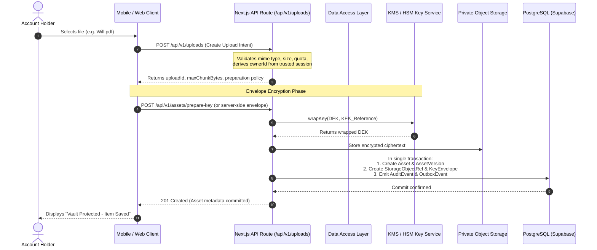
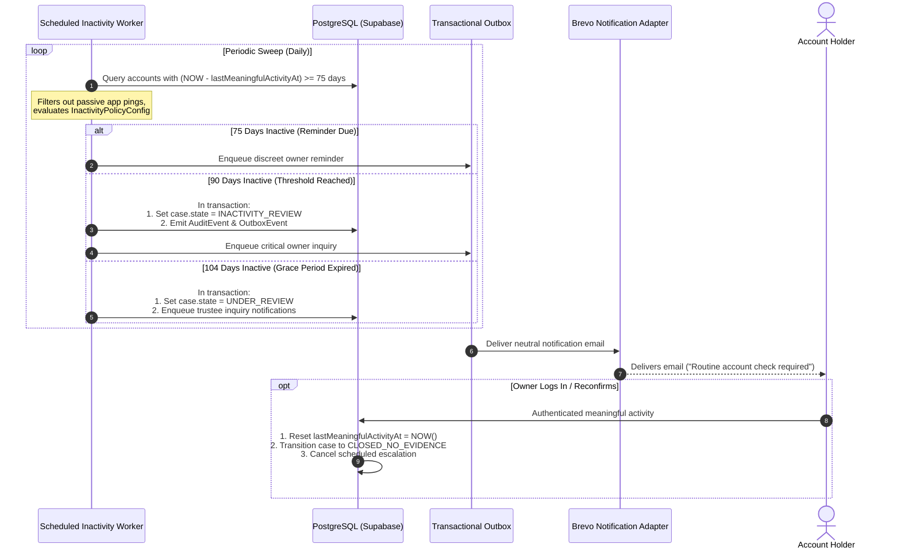
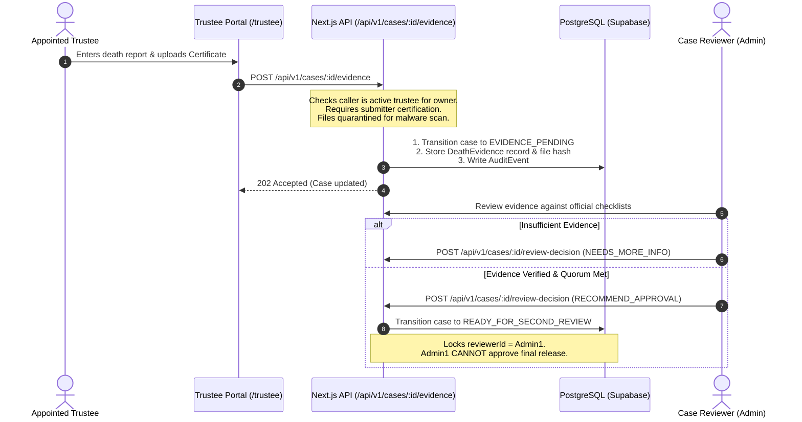
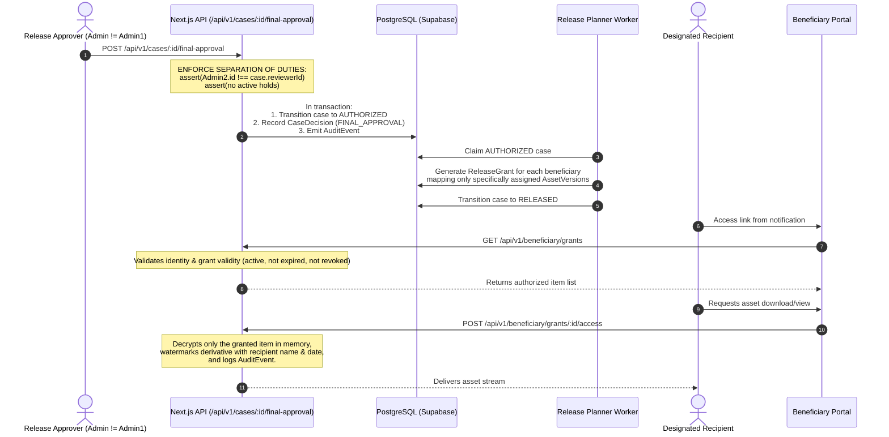

# End-to-End Data Flow & Sequence Specifications
**Portfolio Immortalized — Pie Corp Limited**
**Document Control:** TDD Chapter 10, 11, 13, 18, 23 & 24

This document defines the primary request paths and stateful lifecycles for critical platform workflows.

---

## 1. Owner Vault Upload & Envelope Encryption Flow

---

## 2. Inactivity Monitoring & Concern Escalation Flow

---

## 3. Trustee Death Evidence Submission & Review

---

## 4. Two-Person Final Release & Beneficiary Access Flow

